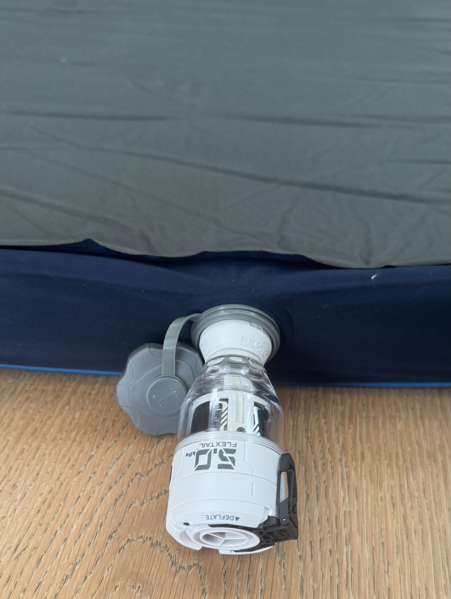
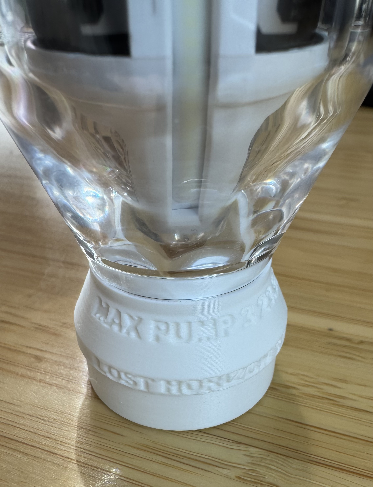
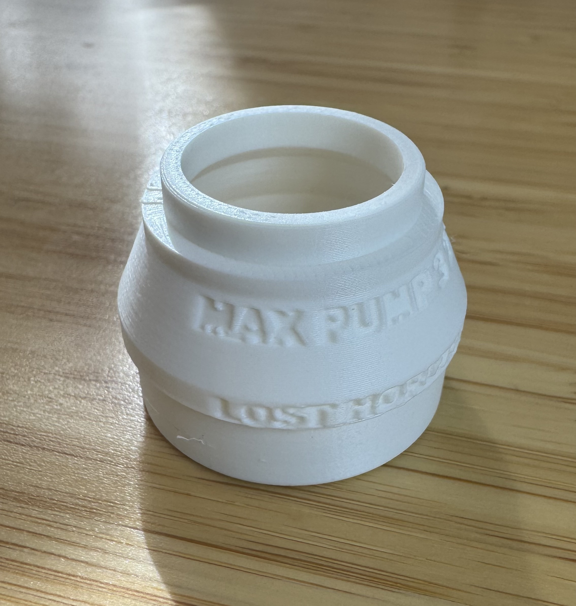
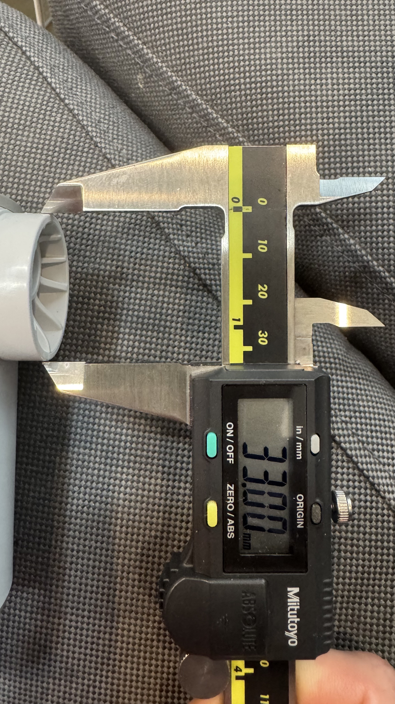
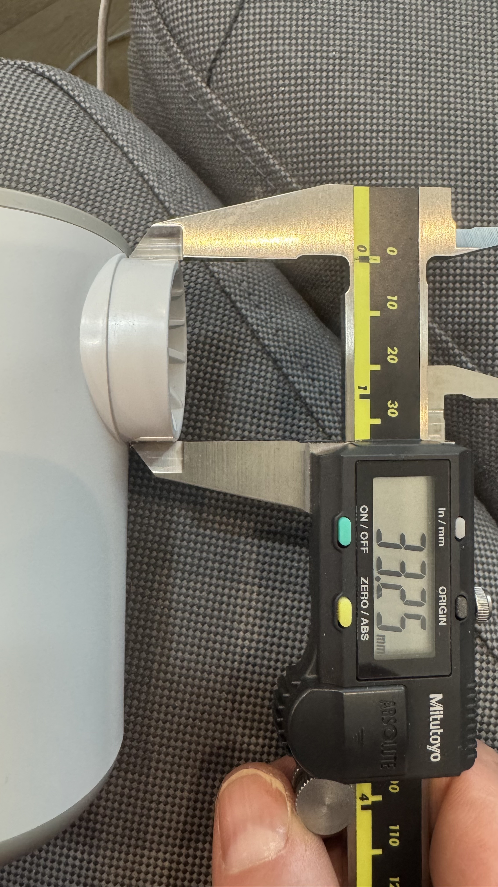
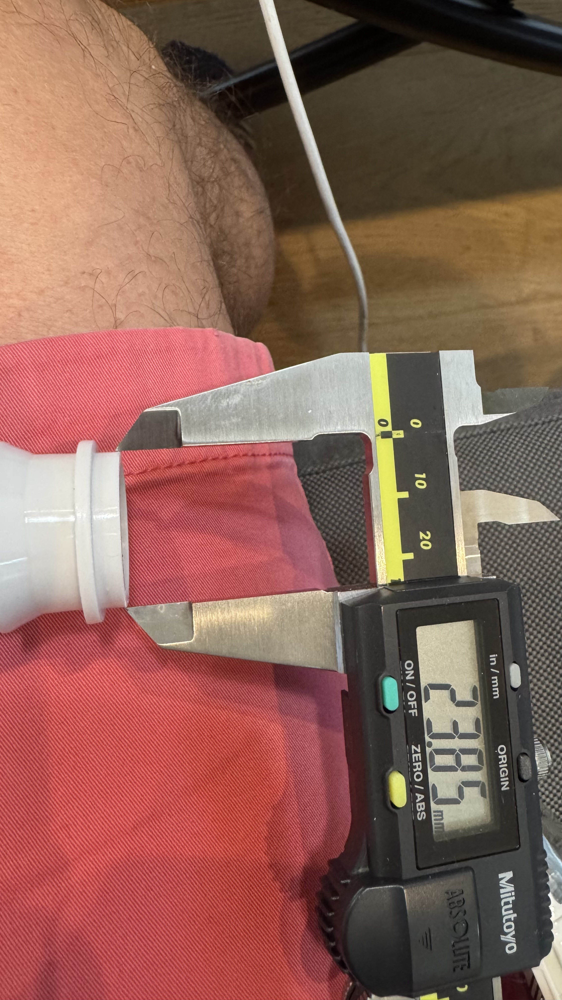
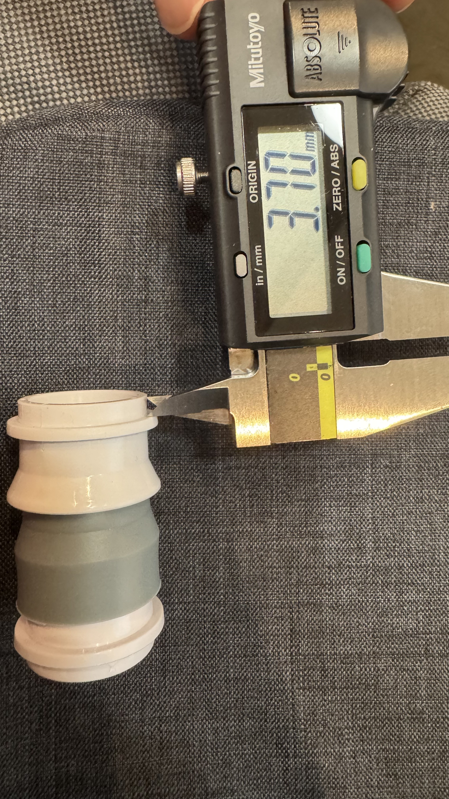

# Flextail Max Pump 3 → Lost Horizon mattress adaptor

Lets you inflate and deflate a Lost Horizon sleeping mattress with a Flextail Max Pump 3.

The original Lost Horizon pump died, the Max Pump 3 doesn't ship with an adaptor for the mattress, and no model existed for this pump and valve pair. So this one is generated from scratch by a parametric Blender script, from caliper measurements of both originals.

Published on MakerWorld: https://makerworld.com/en/models/3449407-flextail-max-pump-3-lost-horizon-adaptor

  

## What it connects

| End | Taken from | Measured (tip → base) | Printed (tip → base) |
| :--- | :--- | :--- | :--- |
| Mattress nozzle | the original Lost Horizon pump nozzle, 8.7 mm long | 33.00 → 33.25 mm | 33.10 → 33.35 mm |
| Pump plug | a Flextail nozzle attachment, 3.7 mm past its collar | 23.85 → 23.96 mm | 23.95 → 24.06 mm |

Both ends are press fits. Each is engraved with its name and its printed tip diameter, so a part in a drawer says what it fits: `MAX PUMP 3 • 23.95 MM` around the top of the cone and `LOST HORIZON • 33.10 MM` on the stop ring.

The printed sizes are 0.1 mm larger than measured. That offset was picked by printing test rings and trying them on the real pump and the real valve, not calculated. See [Fit testing](#fit-testing).

### The measurements

   

Mattress nozzle at the tip and at the base, pump plug at the tip, and how far the plug sticks out past its collar. Taken with a Mitutoyo caliper; every reading is in `pictures/`.

The measured values stay untouched in `build_adaptor.py`. `NOZZLE_FIT_OFFSET` and `PLUG_FIT_OFFSET` adjust the printed diameters on top of them.

## Printing

Print it **mattress tip down, pump plug up**, which is how the STL sits. No supports are needed; the steepest overhang is 45°.

| Setting | Value | Why |
| :--- | :--- | :--- |
| Layer height | 0.16 mm | smoother sealing surfaces |
| Supports | off | nothing overhangs far enough |
| Brim | off | a brim attaches to the nozzle tip, the surface that seals |
| Seam position | back | keeps the seam line off the labels |
| X-Y contour compensation | 0 | the fit offset is already in the model |

Printed on a Bambu Lab X1C in PLA. PETG works too and copes better with heat in a car or tent, but the fit offsets were tuned in PLA, so retest a ring if you switch.

## Fit testing

Printers vary, so if a press fit comes out too tight or too loose, print the rings in `out/fit-test/` instead of whole adaptors. Each is just one end of the part, a few millimetres tall, at a different offset from the measurements.

The rings look alike once printed, so each is marked with notches on a surface that doesn't touch anything:

| Mark | Meaning |
| :--- | :--- |
| no notch | the measured size |
| narrow notches | 0.1 mm **smaller** than measured, per notch |
| wide notches | 0.1 mm **larger** than measured, per notch |

Print them with the same filament and profile you'll use for the adaptor, and with the brim off. The right ring goes in with firm hand pressure, doesn't wobble, and comes out by hand. Then set `NOZZLE_FIT_OFFSET` or `PLUG_FIT_OFFSET` in `build_adaptor.py` to the winning value and rebuild.

On the X1C, both ends won at +0.1 mm, which is why that's the default.

## Rebuilding the model

Everything is generated by `build_adaptor.py`. All dimensions are settings at the top of the file, and 1 Blender unit = 1 mm.

```sh
blender -b -P build_adaptor.py
```

It rebuilds `out/max-pump-3_lost-horizon_adaptor.stl`, the rings in `out/fit-test/` and the `.blend`, checking that each mesh is watertight and measuring the diameters back.

The labels use macOS's Arial Black. Elsewhere, Blender's thinner built-in font is used instead.

| Path | What it is |
| :--- | :--- |
| `build_adaptor.py` | the script that generates everything |
| `out/max-pump-3_lost-horizon_adaptor.stl` | the part to print |
| `out/fit-test/` | fit-test rings, 5 offsets per end |
| `max-pump-3_lost-horizon_adaptor.3mf` | Bambu Studio project for the X1C |
| `pictures/` | caliper measurements of both originals |
| `final/` | photos and a video of the printed part |

## Credit

Designed with the GitHub Copilot app running Claude Opus 5.5, driving Blender through the Blender MCP server.
